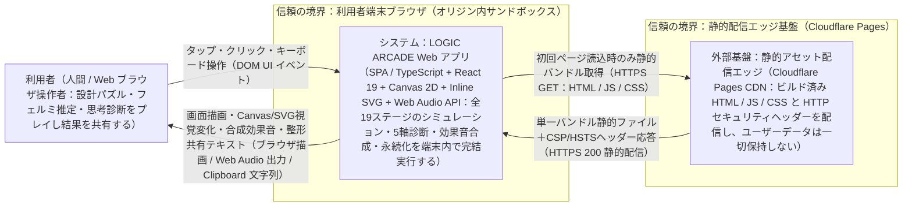
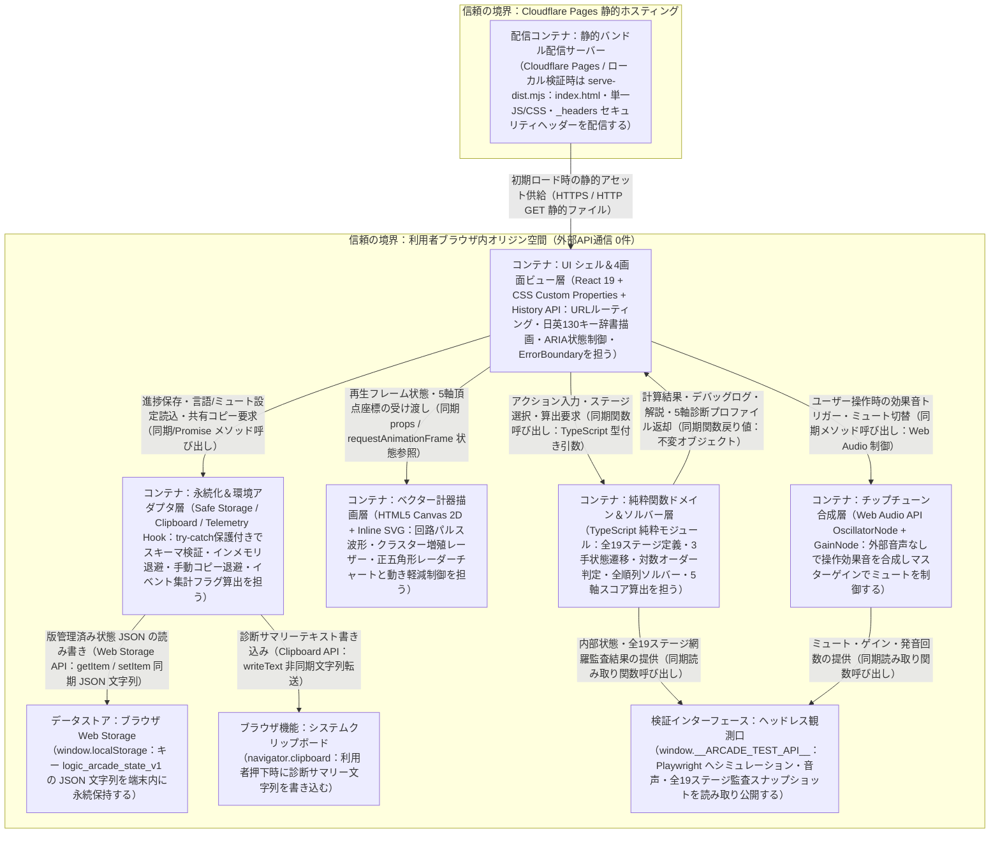

# A 技術設計メモ 001-arcade-core：レトロアーケード型エンジニア思考ゲーム＆思考力診断カルテ

- 書いた役：tech-lead　日付：2026-11-12
- PRD：docs/prd/001-arcade-core.md　デザイン：design/001-arcade-core.md　契約：contracts/openapi.yaml（テストつなぎ口・全19ステージ確定仕様：contracts/arcade-test-seam.md）

## 1. 範囲、目標、非目標
- **範囲**：
  - 共通アーケードシェル（上部 `<header>`、`<nav aria-label>` 標準リンクナビゲーション、常設ミュート切替トグル `header-sound-toggle`＋状態バッジ `header-sound-state`、`JA / EN` 言語切替、保存退避通知 `storage-fallback-banner`、エラーバウンダリ、未定義 URL 404 フォールバック `not-found-section`）と4画面（`/` モード選択、`/combinator` モード1『3-ACT COMBINATOR』全10ステージ、`/fermi` モード2『FERMI BLASTER』全9ステージ、`/diagnostic`『思考力診断カルテ』）の単一バンドル SPA 実装。
  - 純粋関数による決定論的シミュレーションエンジン、全順列 `P(n,3)`・全組み合わせ網羅ソルバー、5軸整数スコア＆総合認定ランク（`UNRANKED` / `C`〜`S+`）算出エンジン、Web Audio API による外部音源なしのチップチューン合成エンジン、`localStorage` 版管理（`logic_arcade_state_v1`）と例外・破損 JSON フォールバック、Clipboard API 共有コピーと拒否時手動コピー `<textarea readonly>` 退避、クライアント内 KPI イベント発火フック、およびヘッドレス検証用 `window.__ARCADE_TEST_API__`。
- **目標**：
  - アカウント登録0秒・初期3導線操作可能まで `1.0秒以内`、`LCP <= 2.5秒`、`INP <= 200ms`、`CLS <= 0.1`、初期読込 JS（gzip 圧縮後合計）`120 KB 以下`、初期ロード後の外部ネットワーク通信 `0件`・完全オフライン完走（`AC-14`）、全19ステージのプログラム的解存在保証（`AC-4`, `AC-19`）、WCAG 2.2 AA 自動監査違反 `0件`（`AC-17`, `AC-18`）を達成する。
- **非目標（この設計でやらないこと）**：
  - バックエンド API（`backend/`）・DB・認証・オンライン全国ランキング・ユーザーステージ自作エディタ・LLM 自由記述採点の実装（PRD 9〜10章）。
  - パックマン等の十字キー迷路ドットイートアクションゲームの実装、外部音声ファイル（`.mp3` / `.wav` 等）・外部 Web フォント・外部 CDN の参照、ユーザー操作前の自動音声再生、未実装プレースホルダー（`Coming Soon`）の配置。

## 2. 受け入れ条件の対応表
PRD の全20件（`AC-1`〜`AC-20`）はすべてブラウザ単体で完結するため、`operationId` は全行 `なし（端末のみ）` である。エンティティ型はすべて `contracts/openapi.yaml` の `components.schemas` から `openapi-typescript` でビルド時に生成する。

| AC | 画面（design/） | operationId | データ（エンティティ） | 確かめるテスト |
|---|---|---|---|---|
| AC-1 | 画面1：モード選択（`/`）および全画面共通ヘッダー | なし（端末のみ） | `ResolvedRoute`, `PersistedArcadeStateV1`, `DiagnosticProfile` | Playwright `AC-1`: `/` 初期表示 `<= 1.0s` で `lobby-mode-combinator` / `fermi` / `diagnostic` と `nav-mode-*` が操作可能、迷路盤面・`Coming Soon`・未実装ボタン `0件` |
| AC-2 | 画面2：モード1『3-ACT COMBINATOR』（`/combinator?stage=1..10`） | なし（端末のみ） | `CombinatorStageDefinition`, `CombinatorModule` | Playwright `AC-2`: `combinator-stage-1`〜`10` 切替で各5〜7枚の `combinator-module-card-{k}`（4属性 `effect`/`cost`/`side-effect`/`condition`）と `combinator-target-condition`・`combinator-overheat-limit` 表示を検証 |
| AC-3 | 画面2：モード1『3-ACT COMBINATOR』（`/combinator`） | なし（端末のみ） | `CombinatorStageDefinition`, `SimulationSnapshot`, `CombinatorStageRecord` | Playwright `AC-3`: 代表正解順列を `combinator-slot-1`〜`3` に配置し `combinator-run-button` 押下 → `<= 3.0s` で `combinator-result-status` が `STAGE CLEAR`、`combinator-score-value` 表示、`data-cleared="true"` 記録を検証 |
| AC-4 | 画面2：モード1『3-ACT COMBINATOR』（`/combinator?stage=1..10`） | なし（端末のみ） | `CombinatorStageDefinition`, `StageAuditReport`, `CombinatorStageAuditEntry` | 単体テスト `solver.test.ts` ＋ Playwright `AC-4`: `window.__ARCADE_TEST_API__.auditAllStages()` で全10ステージ `P(n,3)` 網羅走査（正解 `>= 1` かつ `<= 50%`、ステージ8〜10は副作用機構または `if` 発火なしクリア `0通り`）および画面実走を検証 |
| AC-5 | 画面2：モード1『3-ACT COMBINATOR』（`/combinator`） | なし（端末のみ） | `SimulationSnapshot`, `PersistedArcadeStateV1` | Playwright `AC-5`: `combinator-step-button` 1回押下で `officialAttemptCount` 非加算・`stepIndex === 1`・`STEPPING` 一時停止、続く `combinator-reset-button` から `<= 0.2s` で3スロット維持のまま `stepIndex === 0`・初期パラメータ・`IDLE` 復帰を検証 |
| AC-6 | 画面2：モード1『3-ACT COMBINATOR』（`/combinator`） | なし（端末のみ） | `SimulationSnapshot`, `CombinatorDebugLog` | 単体テスト ＋ Playwright `AC-6`: (a) 途中枯渇／暴走配置で該当 `STEP 1..3` 中断・`CRASHED`、(b) 完走目標未達配置で `FINAL CHECK`・`FAILED`、双方で `combinator-debug-location` / `reason` / `values` の3項目表示を検証 |
| AC-7 | 画面3：モード2『FERMI BLASTER』（`/fermi?stage=1..9`） | なし（端末のみ） | `FermiStageDefinition`, `FermiHypothesisSlot`, `FermiHypothesisCard` | Playwright `AC-7`: 初級1〜3・中級4〜6・上級7〜9の `fermi-stage-1`〜`9` 選択可能、`input[type=number]` 等の自由入力欄 `0件`、各スロット3〜4枚の `fermi-card-act{s}-{c}` から1枚ずつ計3枚選択可能を検証 |
| AC-8 | 画面3：モード2『FERMI BLASTER』（`/fermi`） | なし（端末のみ） | `FermiStageDefinition`, `SimulationSnapshot`, `FermiStageRecord`, `FermiJudgment` | 単体テスト ＋ Playwright `AC-8`: `fermi-fire-button` 押下から `<= 3.0s` で `d = log10(est/base)` と罠枚数に従い `PERFECT ORDER` / `GOOD RANGE` / `OVERKILL` / `UNDERESTIMATE` 表示、上位2判定時のクリア記録を検証 |
| AC-9 | 画面3：モード2『FERMI BLASTER』（`/fermi`） | なし（端末のみ） | `FermiExplanation`, `SimulationSnapshot` | Playwright `AC-9`: `FIRE` 後に `fermi-comparison-values`・`fermi-baseline-breakdown`（`ACT 1 × ACT 2 × ACT 3` 式＋解説）・`fermi-trap-notes`（罠名＋理由）表示、続く `fermi-reset-button` から `<= 0.2s` で全スロット未選択・`IDLE` 復帰を検証 |
| AC-10 | 画面4：『思考力診断カルテ』（`/diagnostic`） | なし（端末のみ） | `PersistedArcadeStateV1`, `DiagnosticProfile`, `DiagnosticAxisScores` | 単体テスト `diagnostic.test.ts`（5軸 `Math.round` 式・全ランク境界）＋ Playwright `AC-10`: 両モード各1以上クリア状態で5軸整数スコア・`diagnostic-radar-chart`（5頂点 SVG）・`diagnostic-overall-rank`（`S+`〜`C`）・`diagnostic-copy-button` 活性を検証 |
| AC-11 | 画面4：『思考力診断カルテ』（`/diagnostic`） | なし（端末のみ） | `DiagnosticProfile`, `ShareResultState` | Playwright `AC-11`: ランク解放かつ Clipboard 許可状態で `diagnostic-copy-button` 押下 → クリップボード文字列に総合ランクと全5軸名・整数スコアを含み、`diagnostic-copy-toast` が `>= 2.0s` 表示されることを検証 |
| AC-12 | 画面4：『思考力診断カルテ』（`/diagnostic`） | なし（端末のみ） | `PersistedArcadeStateV1`, `DiagnosticProfile` | Playwright `AC-12`: 履歴0件・失敗のみ・片モードのみクリアの各状態で例外 `0件`、`UNRANKED`、`diagnostic-copy-button` が `disabled`、未クリア側軸スコア `0`（クリア済側は算出値）、未クリア側開始ボタン表示を検証 |
| AC-13 | 画面2（`/combinator`）および画面3（`/fermi`） | なし（端末のみ） | `SimulationSnapshot`, `PersistedArcadeStateV1` | Playwright `AC-13`: 未配置スロット `>= 1` のとき `combinator-run-button`・`combinator-step-button` および `fermi-fire-button` が `disabled`、不足スロット名入り `*-slot-guidance` 1件表示、再生・試行加算 `0回` を検証 |
| AC-14 | 全4画面（`/`、`/combinator`、`/fermi`、`/diagnostic`） | なし（端末のみ） | `PersistedArcadeStateV1`, `DiagnosticProfile` | Playwright `AC-14`: 初期読込後に `context.setOffline(true)` で両モード各1ステージクリア＋カルテ更新（例外・外部通信失敗 `0件`）、オンライン復帰リロード後にクリア数と5軸スコアが一致復元されることを検証 |
| AC-15 | 全画面共通ヘッダーおよび画面2・画面3 | なし（端末のみ） | `PersistedArcadeStateV1`, `AudioStateSnapshot` | Playwright `AC-15`: 初回既定 `SOUND ON`・操作前 `autoPlayBeforeGestureCount === 0`・外部音声リクエスト `0件`、`RUN`/`FIRE` で `synthTriggerCount >= 1`、`header-sound-toggle` 切替後 `masterGainValue === 0`、リロード後も `SOUND OFF` 維持を検証 |
| AC-16 | 全4画面および共通ヘッダー直下通知バー | なし（端末のみ） | `PersistedArcadeStateV1`, `StorageStatus` | 単体テスト ＋ Playwright `AC-16`: `addInitScript` で (a) `window.localStorage` getter 例外注入時と (b) 破損 JSON 注入時の双方で未捕捉例外 `0件`・両モードクリア＋ランク算出完走、(a) の `storage-fallback-banner` 表示、(b) の破棄再記録を検証 |
| AC-17 | 画面2（`/combinator`）および画面3（`/fermi`） | なし（端末のみ） | `SimulationSnapshot` | Playwright `AC-17`: `page.emulateMedia({ reducedMotion: 'reduce' })` 有効時に `RUN` / `FIRE` を実行し、`maxShakeOffsetPx === 0` かつ押下から結果表示まで `<= 1.0s` で完了することを検証 |
| AC-18 | 全4画面（`/`、`/combinator`、`/fermi`、`/diagnostic`） | なし（端末のみ） | `ResolvedRoute`, `DiagnosticProfile` | Playwright `AC-18`: `320px×100%`・`1280px×100%`・`1280px×200%`・`320px×200%` の4条件×全4画面で `scrollWidth - innerWidth === 0`、全操作要素 `>= 24x24px`、重なり押下不能 `0件`、および5通りスクリーンショットを検証 |
| AC-19 | 画面3：モード2『FERMI BLASTER』（`/fermi?stage=1..9`） | なし（端末のみ） | `FermiStageDefinition`, `StageAuditReport`, `FermiStageAuditEntry` | 単体テスト `solver.test.ts` ＋ Playwright `AC-19`: `window.__ARCADE_TEST_API__.auditAllStages()` で全9ステージ全カード組を網羅走査（`PERFECT ORDER` が `>= 1` かつ `<= 50%`、各ステージ選択肢プールに罠カード `>= 1枚`）および画面実走を検証 |
| AC-20 | 画面4：『思考力診断カルテ』（`/diagnostic`） | なし（端末のみ） | `DiagnosticProfile`, `ShareResultState` | Playwright `AC-20`: ランク解放状態で `navigator.clipboard.writeText` 例外／未定義を注入し `diagnostic-copy-button` 押下 → 未捕捉例外 `0件`、`diagnostic-copy-error` 1件表示、`diagnostic-manual-copy-textarea` にランクと全5軸名・整数スコアが含まれることを検証 |

## 3. 構成図

### システムコンテキスト図


### コンテナ図


## 4. 契約の変更と互換性
本機能はバックエンド API を持たないブラウザ単体完結構成（PRD 10章）であるため、`contracts/openapi.yaml`（OpenAPI 3.1.0）の `paths` は `{}`（HTTP エンドポイント `0件`、認可空欄 `0件`）とし、`components.schemas` に永続化データモデル・全19ステージ構造・診断カルテ算出結果・全9イベント・`window.__ARCADE_TEST_API__` 返却型のすべてを機械可読スキーマとして定義する。Web 側は `openapi-typescript` でビルド時に `src/generated/contracts.d.ts` を自動生成し、契約と実装の型が1か所でもずれれば `npm run build`（`tsc --noEmit`）が失敗する。

| operationId | 足す / 変える | AC | 認証 | 作る POST の Idempotency-Key |
|---|---|---|---|---|
| なし（端末のみ・HTTP エンドポイント 0件） | 対象外（`components.schemas` 新規作成） | AC-1〜AC-20 | 不要（認証なし・公開静的Web） | 対象外（POST なし） |

- spectral の出力：
  ```text
  $ npx --yes @stoplight/spectral-cli lint contracts/openapi.yaml --ruleset contracts/.spectral.yaml --fail-severity warn
  No results with a severity of 'warn' or higher found!
  ```
- oasdiff breaking の出力（main に契約がなければ「新規」）：
  - 新規（`origin/main` に `contracts/openapi.yaml` が未存在であることを確認のうえ、空ベースラインとの `oasdiff breaking` でも破壊的変更 `0件` を確認）：
  ```text
  $ git cat-file -e origin/main:contracts/openapi.yaml 2>/dev/null && echo "EXISTS_ON_MAIN" || echo "NOT_ON_MAIN (新規契約)"
  NOT_ON_MAIN (新規契約)
  $ oasdiff breaking /tmp/empty-base-openapi.yaml contracts/openapi.yaml --fail-on ERR
  No breaking changes to report, but the specs are different.
  Run 'oasdiff diff' to see structural differences.
  ```
- 互換性を壊す変更：なし（新規 `v1.0.0` 契約）
- 返す enum に足した値と、古いアプリが unknown として扱えることを確かめるテスト：
  - `PersistedArcadeStateV1` を `localStorage` から読み込むデコーダ（`migratePersistedState`）において、`locale`（`'ja' | 'en'`）やステージ最高判定 `bestJudgment`（`'PERFECT_ORDER' | 'GOOD_RANGE'`）に将来新しい enum 値や未知プロパティが追加された JSON（またはダウングレードや古いタブとの競合で未知値が入った JSON）を読み込んだ際、例外を送出せず既定値（`locale: 'ja'`、未知判定レコードは安全スキップまたは既知範囲へ正規化）へフォールバックすることを単体テストおよび `verifier` の `localStorage` シード検証で確認する。
- エラーの type と、アプリに出す文言（design/ の文言表の項目）：
  - HTTP API エラー（`application/problem+json`）はエンドポイント `0件` のため発生しない。クライアント内の境界エラー・失敗種別と `design/001-arcade-core.md` 第7章の文言キーの対応は下表に固定する（`contracts/openapi.yaml` の `ClientErrorNoticeType`・`CombinatorFailureReason` と1対1対応）。

| クライアントエラー / 失敗種別 | 発生条件 | アプリに出す文言キー（`design/001-arcade-core.md` 第7章） | 表示要素（`data-testid`） |
|---|---|---|---|
| `STORAGE_UNAVAILABLE` | `window.localStorage` getter / `getItem` / `setItem` が `SecurityError` / `QuotaExceededError` 等を送出（`AC-16 (a)`） | `banner.storageFallback` | `storage-fallback-banner` |
| `CLIPBOARD_DENIED` | `navigator.clipboard` 未定義または `writeText` が例外送出（`AC-20`） | `diagnostic.copy.errorFallback` ＋ `diagnostic.copy.manualLabel` | `diagnostic-copy-error`, `diagnostic-manual-copy-textarea` |
| `STAGE_QUERY_OUT_OF_RANGE` | `/combinator?stage=` に `1..10` 以外、または `/fermi?stage=` に `1..9` 以外が指定されたとき | `common.stageFallbackNotice` | `stage-fallback-notice` |
| `ROUTE_NOT_FOUND` | 定義済み4パス以外の未知 URL パスへアクセスしたとき | `error.notFound.heading`, `error.notFound.message`, `error.notFound.backToLobby` | `not-found-section`, `not-found-home-link` |
| `RENDER_RUNTIME_ERROR` | 予期せぬ React 描画例外を `ErrorBoundary` が捕捉したとき | `error.boundary.message`, `error.boundary.reload` | `error-reload-button` |
| `ENERGY_DEPLETED` | モード1実行ステップで `energy < 0` となり中断（`AC-6 (a)`） | `combinator.status.crashed`, `combinator.debug.reason.energy` | `combinator-result-status`, `combinator-debug-reason` |
| `OVERLOAD_EXCEEDED` | モード1実行ステップで `sideEffect > overloadLimit` となり中断（`AC-6 (a)`） | `combinator.status.crashed`, `combinator.debug.reason.overheat` | `combinator-result-status`, `combinator-debug-reason` |
| `TARGET_UNMET` | モード1の3手完走時点で `output < targetOutput`（`AC-6 (b)`） | `combinator.status.failed`, `combinator.debug.reason.unmet` | `combinator-result-status`, `combinator-debug-reason` |

## 5. データモデルと移行

| エンティティ | 正しいデータの置き場所（端末 / サーバー） | 個人情報か | 保存期間 | 消し方 |
|---|---|---|---|---|
| `PersistedArcadeStateV1`（クリア履歴・試行集計・ミュート設定・表示言語・匿名コホート真偽値算出用タイムスタンプ） | 端末のみ（`window.localStorage['logic_arcade_state_v1']`、不可時はタブ内メモリ） | いいえ（氏名・メール・端末固有ID・自由記述テキストすべてなし） | 利用者がブラウザのサイトデータを消去するまで無期限（インメモリ退避時はタブを閉じるまで） | ブラウザ設定の「閲覧履歴／サイトデータの削除」または DevTools `localStorage.removeItem('logic_arcade_state_v1')` で即座に完全消去 |
| `CombinatorStageDefinition`（モード1全10ステージ定義・日英対訳） | 端末のみ（初期配信 JS バンドル内の不変定数） | いいえ（静的マスタデータ） | アプリ配信版と同一 | 不要（ユーザーデータを含まない静的コード定数） |
| `FermiStageDefinition`（モード2全9ステージ定義・基準式・罠理由・日英対訳） | 端末のみ（初期配信 JS バンドル内の不変定数） | いいえ（静的マスタデータ） | アプリ配信版と同一 | 不要（ユーザーデータを含まない静的コード定数） |
| `SimulationSnapshot`（現在ステージのスロット配置・再生状態・現在パラメータ・デバッグログ・シェイク変位） | 端末のみ（React メモリ状態） | いいえ | ステージ切替・`RESET`・タブ終了まで | `RESET` ボタン押下（`<= 0.2s`）またはタブ終了で即時破棄 |
| `DiagnosticProfile`（5軸整数スコア `0..100`・`overallScore`・総合認定ランク・共有テキスト） | 端末のみ（`PersistedArcadeStateV1` から純粋関数でオンデマンド算出） | いいえ | 永続化せず毎回メモリ上で算出 | 元データ `PersistedArcadeStateV1` の削除と同時に消滅 |
| `SessionTelemetryEvent`（PRD 15章の9イベント構造体） | 端末のみ（`001-arcade-core` ではメモリ内リングバッファ保持のみ・外部送信 `0件`） | いいえ（コホート boolean とゲーム状態列挙値のみ） | タブを閉じるまで（最大直近200件をメモリ保持） | タブの再読み込みまたは終了で即時消滅 |

- クライアント保存スキーマの版管理（SwiftData `VersionedSchema` の Web 読み替え）：
  - 保存キーを `logic_arcade_state_v1` に固定し、ルートオブジェクト必須フィールド `schemaVersion: 1` を持たせる（ADR-002）。
  - 読み込み時は必ず `migratePersistedState(rawJson: string | null)` を通し、(1) `JSON.parse` 例外時は破損データを破棄して初期 `v1` 状態を返却（`AC-16 (b)`）、(2) 未知の `schemaVersion`・型不一致・負数や `NaN`・存在しないステージ ID を検出した場合も例外を出さず安全な初期値／有効部分のみ正規化して復元する。将来 `schemaVersion: 2` を導入する際は `v1 -> v2` の純粋マイグレーションステージ関数を追加する。
- 前の版のストアを開けるかのテスト（`verifier`・単体テストに頼む項目）：
  - (1) 有効な `v1` シード JSON の復元（`AC-14`）、(2) 破損 JSON 文字列（`"{broken"`）からの安全初期化と再記録（`AC-16 (b)`）、(3) 未知 enum 値・未知プロパティを含む JSON からの無例外フォールバック、(4) `window.localStorage` getter 例外時のインメモリ退避＋`storage-fallback-banner` 表示（`AC-16 (a)`）を検証する。
- サーバーの DB の変更と段階（足す、移す、消す）：
  - なし（バックエンド DB 不使用。`.claude/org/app.json` の `backend/` は本機能では作成しない）。

## 6. 非機能の目標

| 項目 | 目標 | 測り方と時期 | 確かめる役 |
|---|---|---|---|
| 初期表示と操作反応 | ナビゲーション開始から初期3導線が操作可能になるまで `1.0秒以内`（`AC-1`）。`RESET` 押下から初期状態復帰まで `0.2秒以内`（目標 `100ms 以下`：`AC-5`, `AC-9`）。通常再生完了 `3.0秒以内`（目標 `2.4秒以下`：`AC-3`, `AC-8`）、動き軽減時再生完了 `1.0秒以内`（目標 `450ms`：`AC-17`） | Playwright `performance.now()` / Navigation Timing 実測テスト（G2、G3） | verifier |
| Web の速さ（Core Web Vitals とバンドル予算） | `LCP <= 2.5秒`、`INP <= 200ms`、`CLS <= 0.1`、Lighthouse Performance スコア `>= 90`。初期読込 JS バンドル合計（gzip 圧縮後）`120 KB 以下`（`122,880 bytes 以下`）、初期 CSS（gzip 圧縮後）`20 KB 以下` | `npm run build` 内の gzip サイズ自動検査スクリプト（G2）、`web/lighthouse-budget.json` と `lighthouse@13.6.0` による自動計測（G3）、公開後は Cloudflare Web Analytics RUM p75（G6） | web-engineer、verifier |
| API（エンドポイントごと） | バックエンド API エンドポイントは `0件`（端末完結）。静的 HTML/JS/CSS 配信のローカル応答は `50ms 以内`・HTTP 5xx 失敗率 `0.0%`（本番エッジ TTFB p95 `300ms 以内`・5xx 率 `0.1% 未満`） | Playwright 全画面遷移の HTTP ステータス監視（G3）、公開後はホスティング配信メトリクス（G6） | verifier |
| オフライン（全4画面ごと） | 画面1（`/`）・画面2（`/combinator`）・画面3（`/fermi`）・画面4（`/diagnostic`）の全4画面すべてが初期読み込み完了後に `offline` 状態で `100%` 閲覧・実行・クリア記録・診断算出可能、未捕捉例外 `0件`（`AC-14`）。端末単体完結のためサーバーとのデータ競合は `0件` | Playwright `context.setOffline(true)` 完走テストおよび外部リクエスト遮断時の `pageerror` `0件` 検証（G3） | verifier |
| ブラウザ資源・タイマー・音声負荷 | バックグラウンド常駐ポーリング `0件`、未解放 `requestAnimationFrame` / タイマーリーク `0件`、秒間3回超の点滅 `0件`、操作前の自動音声再生 `0回`、`SOUND OFF` 時のマスター出力ゲイン `0` | コード検査（G2）および Playwright `getAudioState()`・ネットワーク監視テスト（G3） | reviewer、verifier |
| セキュリティ | ソース・バンドル内の秘密情報 `0件`、`dangerouslySetInnerHTML` / `eval` 使用 `0件`、認証トークン保存 `0件`、配信レスポンスに CSP（`default-src 'self'; script-src 'self'; object-src 'none'; frame-ancestors 'none'` 等）・`X-Content-Type-Options: nosniff`・`Referrer-Policy`・`Permissions-Policy`（本番は HSTS も）を付与し CSP 違反 `0件` | `grep` とコード監査（G2）、ローカル配信およびステージングへの `curl -sI` ヘッダー検査・OWASP ASVS L1 監査（G4） | reviewer |
| プライバシー | 個人データ収集 `0件`、Cookie 発行数 `0件`、初期配信後の外部オリジン通信 `0件`（G5 で匿名解析接続時は `docs/support/` の外部送信公表と100%一致） | Playwright `context.cookies()` 空配列検査・外部オリジン通信 `0件` 監視（G3）、G4/G5 プライバシー表記照合 | reviewer、tech-lead |
| アクセシビリティ | WCAG 2.2 AA 準拠：`@axe-core/playwright` 違反 `0件`（全4画面×全状態）、通常文字コントラスト `>= 4.5:1`・UI枠／図形 `>= 3.0:1`、押下領域 `>= 24x24px`、`320px`/`1280px` × `100%`/`200%` の4条件で横はみ出し `0px`・重なり不能 `0件`（`AC-18`）、動き軽減時シェイク `0px`（`AC-17`）、キーボード単体完走率 `100%` | `@axe-core/playwright` 自動監査、Playwright 4条件レイアウト＆キーボード完走テスト、5通りスクリーンショット監査（G3） | verifier、design-reviewer |
| 言語・辞書整合 | 既定言語 `ja`、`ja` / `en` UI 辞書（全130キー）および全19ステージ対訳データの欠落キー・余剰キー・空文字列・プレースホルダー不一致すべて `0件` | 単体テスト `i18n.test.ts` での双方向キー・プレースホルダー完全一致検査（G2）および英語表示スクリーンショット確認（G3） | web-engineer、verifier |

## 7. 脅威モデル
本機能はリポジトリ最初の機能であり、「静的配信サーバーから利用者ブラウザへの配信境界」「URL クエリパラメータ（`?stage=`）および `localStorage` からの信頼できない入力境界」「Clipboard API 呼び出し境界」を新設するため、STRIDE の軽い脅威モデルを定義する。

- **何を作るか（守るものと境界）**：
  - 守るもの：(1) 利用者ブラウザ上での任意スクリプト実行（DOM XSS）の防止、(2) 破損・改ざんされた `localStorage` や不正 URL パラメータによるアプリクラッシュの防止、(3) 意図しない外部通信・個人データ漏洩・自動音出しの防止。
  - 信頼の境界：ブラウザ DOM／アプリ実行空間と、外部入力となり得る URL パス／クエリ文字列・`window.localStorage` 保存文字列・ブラウザ権限 API（Web Storage / Clipboard / Web Audio）との境界。
- **それで十分か（受け入れた危険と、その理由）**：
  - 利用者自身がブラウザの DevTools から自分の端末の `localStorage`（`logic_arcade_state_v1`）を直接書き換えてクリア状態や認定ランクを変更する行為は**受け入れる**。理由：本機能は課金・景品・オンライン全国ランキングを持たない完全個人用の自己思考トレーニング＆自己診断ゲーム（PRD 10章・16章）であり、自己端末内の書き換えが他利用者や運営サーバーに一切損害を与えないため。ただし書き換えによって不正な型や範囲外数値が注入されてもアプリが例外クラッシュしないよう、読み込み時のスキーマバリデーションは必須とする。

| STRIDE | 起きうること | 対応（減らす / なくす / 移す / 受け入れる） | 確かめるテストか確認 |
|---|---|---|---|
| なりすまし（S） | 第三者スクリプト混入やクリックジャッキング（外部悪意サイトの `<iframe>` 埋め込み）により偽操作を誘導される | **なくす**：認証・アカウント機能自体を持たず、CSP `script-src 'self'; frame-ancestors 'none'` と `X-Frame-Options: DENY` で外部スクリプト読込と埋め込みを遮断する | G2 コード確認、G3 ローカル配信ヘッダー確認、G4 `curl -sI` ヘッダー監査 |
| 改ざん（T） | (1) URL `?stage=999` / `?stage=<script>` 等の不正値注入で DOM XSS や例外停止が起きる<br>(2) DevTools で自己端末の `localStorage` スコアを書き換えられる | (1) **なくす**：React 標準テキストエスケープのみを使い（`dangerouslySetInnerHTML` 禁止）、`?stage=` は整数パース＋範囲検査で `/combinator?stage=1` / `/fermi?stage=1` に正規化する<br>(2) **受け入れる（クラッシュは減らす）**：他者影響がないため自己スコア変更は許容し、`migratePersistedState` の型・境界値検査で例外停止のみ防止する | 単体テスト＋Playwright 不正 `?stage=` 補正検証・破損 `localStorage` 検証（`AC-16`）、G2 `grep` による `dangerouslySetInnerHTML` `0件` 確認 |
| 否認（R） | 本番でクライアント例外率悪化（撤退基準4）が起きた際、どの画面・分類で発生したか判別できない | **減らす**：個人情報を一切含まない分類列挙値（`error_category: runtime\|audio\|storage`, `screen_name`）のみを持つ `Client Error Occurred` イベントを `ErrorBoundary`・Storage/Audio ラッパーから構造化発火する | 単体テストでのイベントペイロード検証 |
| 情報の漏れ（I） | プレイ履歴や端末情報が意図せず第三者サーバーへ送信される、またはソースコード／バンドルに環境変数の秘密値が混入する | **なくす**：`001-arcade-core` では外部送信エンドポイント未設定・外部通信 `0件`・Cookie `0件` とし、Vite の `VITE_*` に秘密値を一切置かない規約を ADR-001 に定める | Playwright での外部オリジン通信 `0件`・`context.cookies()` `0件` 検証（`AC-14`, `AC-15`）、G2/G4 秘密情報検査 |
| サービスの妨害（D） | (1) プライベートブラウズ等で `localStorage` 参照や Clipboard API が例外を投げて画面が真っ白になる<br>(2) `RUN`/`FIRE` 連打で多重アニメーション・多重発音が暴走する | **なくす**：(1) `window.localStorage` getter を含む全 I/O を `try/catch` で包みインメモリ／手動コピーへ即時退避する（`AC-16`, `AC-20`）<br>(2) `RUNNING` 中は実行・リセット・スロット・カード・ステージ選択をすべて `disabled` 化する | Playwright `AC-16`・`AC-20` 例外注入テスト、および再生中ボタン `disabled` 検証 |
| 権限の格上げ（E） | 不要なブラウザ権限（カメラ・マイク・位置情報・通知）が要求される、またはクロスオリジン窓口が開く | **なくす**：`Permissions-Policy: camera=(), microphone=(), geolocation=(), payment=(), usb=()` でブラウザ機能権限を明示拒否し、`postMessage` リスナーや外部通信を持たない | G2 コード確認、G4 `Permissions-Policy` ヘッダー監査 |

## 8. 観測と KPI イベント
- iOS：非該当（Web だけのアプリ）。
- Web：
  - ブラウザのエラーを集める道具：`window.addEventListener('error' / 'unhandledrejection')`、React `ErrorBoundary`、および Storage / Web Audio ラッパーからクライアント内テレメトリディスパッチャ（`emitTelemetryEvent`）へ集約する。`001-arcade-core` 実装・G3 検証時点では外部送信先 URL を未設定（外部通信 `0件`：G0 承認 Q-2 案1）とし、`window.__ARCADE_TEST_API__.getEmittedEvents()` でテストから検証可能にする。G5 本番公開時に Takuma 承認のもと無料 Cookie レス匿名解析（Cloudflare Workers Analytics Engine Free または Umami Cloud Hobby）を接続する。
  - 送らない情報：IP アドレス保存、Cookie 識別子、ブラウザフィンガープリント、自由記述文字列、URL フルパス内のクエリ生文字列、ローカルファイルパスを含むスタックトレース全文は一切イベントに含めない（`contracts/openapi.yaml` の `TelemetryEvent` スキーマで許可された列挙値・数値・boolean のみを通す）。
- 主な流れの計測点：ナビゲーション開始→初期描画完了、`RUN` / `FIRE` 押下→シミュレーション完了、`RESET` 押下→初期状態復帰（`performance.now()` 計測）、公開後の Core Web Vitals（Cloudflare Web Analytics RUM）。
- バックエンド：非該当（`backend/` 不使用）。

| PRD 15 のイベント | 送る場所（アプリ / サーバー） | 使う所（KPI / 撤退基準 / G6 の止める基準） |
|---|---|---|
| `Session Started` | アプリ（ブラウザクライアント発火：`001-arcade-core` は端末内フックのみ、G5 公開時に匿名解析へ送信） | 主 KPI 1「初回訪問での診断カルテ到達率」の分母、撤退基準 1・2・4 のセッション母数、G6 のエラー率分母 |
| `Stage Started` | アプリ（ブラウザクライアント発火：同上） | ステージ別到達・離脱箇所の診断（補助観測） |
| `Simulation Executed` | アプリ（ブラウザクライアント発火：同上） | 主 KPI 2「7日以内再訪プレイ率」（`is_first_7d_return_play=true`）、撤退基準 2「60秒以内初回実行到達率」（`is_first_exec_in_session=true` かつ `within_60s=true`） |
| `Stage Completed` | アプリ（ブラウザクライアント発火：同上） | 主 KPI 2「7日以内再訪プレイ率」のコホート母数（`is_first_ever_clear=true`）、モード別クリア率比較（撤退基準 1 の改修判断材料） |
| `Stage Failed` | アプリ（ブラウザクライアント発火：同上） | ステージ別の詰まり箇所（`CRASHED` / `FAILED` / `OVERKILL` / `UNDERESTIMATE`）診断と難易度バランス監視 |
| `Diagnostic Viewed` | アプリ（ブラウザクライアント発火：同上） | 主 KPI 1「初回訪問での診断カルテ到達率」（`is_first_visit_session=true` かつ `is_first_qualified_in_session=true`）、撤退基準 1、撤退基準 3「共有コピー実行率」の分母 |
| `Diagnostic Copied` | アプリ（ブラウザクライアント発火：同上） | 撤退基準 3「カルテ表示者の共有コピー実行率」（`is_first_copy_in_session=true`） |
| `Audio Toggled` | アプリ（ブラウザクライアント発火：同上） | 音声 ON/OFF 利用比率の把握（害リスクの観測） |
| `Client Error Occurred` | アプリ（ブラウザクライアント発火：同上） | ガードレール KPI「クライアント実行エラー発生セッション率（`< 0.5%`）」、撤退基準 4（`>= 2.0%`）、G6 段階リリースの即時停止基準 |

## 9. 依存ライブラリの変更
`contracts/dependencies.md` に Web 本体（`web/package.json`）用 12 パッケージ（本番 `2`＋開発 `10`）と受け入れテスト（`web/tests/acceptance/package.json`）用 4 パッケージ（うち `typescript` と `@types/node` は共通のためユニーク **14 パッケージ**）を追加した。本番ブラウザバンドルに含まれるランタイム依存は `react` と `react-dom` の **2個のみ** であり、状態管理・ルーティング・チャート・アイコン・CSS・音声合成はすべてブラウザ標準 API と TypeScript 純粋コードで実装する（ADR-001、ADR-002）。

- 追加パッケージ一覧（詳細は `contracts/dependencies.md` 参照）：
  - 本番ランタイム（`web` `dependencies`）：`react@19.3.1`, `react-dom@19.3.1`
  - ビルド・型生成・単体テスト・性能検査（`web` `devDependencies`）：`typescript@5.9.3`, `vite@8.3.8`, `@vitejs/plugin-react@6.3.0`, `@types/react@19.3.0`, `@types/react-dom@19.3.0`, `@types/node@24.19.2`, `openapi-typescript@7.13.0`, `vitest@5.1.0`, `jsdom@31.0.0`, `lighthouse@13.6.0`
  - 受け入れテスト・アクセシビリティ監査（`web/tests/acceptance` `devDependencies`）：`@playwright/test@1.65.0`, `@axe-core/playwright@4.14.0`, `typescript@5.9.3`, `@types/node@24.19.2`
  - ※注意1：npm latest の `typescript@7.0.2` は `openapi-typescript@7.13.0` の `peerDependencies`（`"typescript": "^5.x"`）と競合することを実機確認したため、`5.9.3` に固定した。
  - ※注意2：`@lhci/cli@0.16.0` は古い間接依存により `npm audit` で High 脆弱性9件が発生することを確認したため不採用とし、`npm audit` 脆弱性 `0件` の公式 `lighthouse@13.6.0` を直接採用した。
- 一時ディレクトリ（`/tmp/arcade-spike`、Node `v24.22.1` / npm `12.2.1`）での依存解決・Red 検証・`openapi-typescript` 型生成・`tsc`・`vite build`・`vitest`・`playwright`・`lighthouse`・`npm audit` 実行出力：
  ```text
  # 1. 未ビルド時の受け入れテスト単体 Red 検証（web/dist 未生成・/__health 200 OK）
  $ (cd /tmp/arcade-spike/web/tests/acceptance && npx playwright test --timeout=1500)
  Running 1 test using 1 worker
    ✘  1 [chromium] › specs/smoke.spec.ts:4:1 › AC-1 smoke & axe check (1.5s)
      Error: expect(locator).toBeVisible() failed
      Locator: getByTestId('screen-lobby') / Error: element(s) not found

  # 2. web_build（依存解決 + OpenAPI 3.1 型生成 + tsc + 単一バンドルビルド + gzip 予算検査）
  $ (cd /tmp/arcade-spike/web && npm ci && npm run build && npm audit)
  added 210 packages, and audited 211 packages in 28s
  found 0 vulnerabilities
  ✨ openapi-typescript 7.13.0
  🚀 ../contracts/openapi.yaml → src/generated/contracts.d.ts [36.8ms]
  vite v8.3.8 building client environment for production...
  ✓ 13 modules transformed.
  dist/index.html                  0.34 kB │ gzip:  0.27 kB
  dist/assets/index-JwXGFzuF.js  219.07 kB │ gzip: 68.48 kB
  ✓ built in 69ms
  Bundle budget check: JS gzip=67736B (limit 122880B), CSS gzip=0B (limit 20480B)
  found 0 vulnerabilities

  # 3. web_test（Vitest 単体テスト + Playwright E2E + axe-core + Lighthouse 13.6.0）
  $ (cd /tmp/arcade-spike && (cd web && npm test) && (cd web/tests/acceptance && npm ci && npx playwright test && npm audit))
  RUN  v5.1.0 /private/tmp/arcade-spike/web
   ✓ src/sample.test.ts (1 test) 2ms
   ✓ src/smoke.test.ts (1 test) 2ms
   Test Files  2 passed (2) / Tests  2 passed (2) / Duration  87ms
  added 8 packages, and audited 9 packages in 426ms / found 0 vulnerabilities
  Running 1 test using 1 worker
    ✓  1 [chromium] › specs/smoke.spec.ts:4:1 › AC-1 smoke & axe check (442ms)
    1 passed (966ms)
  found 0 vulnerabilities
  LH_PERF: 1 LH_A11Y: 1 LCP_MS: 610 CLS: 0
  ```

## 10. ADR と未確認
- この機能で書いた ADR：
  - `docs/adr/001-web-foundation.md`（Web の土台：React 19 + Vite 単一バンドル SPA、対応ブラウザ、標準 HTML + CSS トークン部品方針、性能予算、Cloudflare Pages ホスティングとロールバック、CSP 等の安全ヘッダー、テスト基盤、Cookie レス計測方針、古いタブの扱い）
  - `docs/adr/002-client-state-and-simulation-engine.md`（クライアント状態永続化スキーマ `v1`、純粋関数シミュレーション＆全順列／全組み合わせ網羅ソルバー、Web Audio API チップチューン合成エンジン、およびヘッドレス検証用 `__ARCADE_TEST_API__` 境界）
- 未確認の項目、確かめる方法、確かめる役：
  - **なし（0件）**（すべての Web 標準 API、依存パッケージ解決、OpenAPI 3.1 型生成、ビルドサイズ、全19ステージ網羅ソルバー計算、Playwright 実行構成を公式 URL および `/tmp` 実機 spike で確認済み）。

## 確かめ（A）
- [x] 2 の表に PRD の全 AC があり、空の欄がない
- [x] 3 の図のすべての要素に技術と責任が、すべての矢印に用途と通信方式がある
- [x] 契約のすべての operation に operationId、成功とエラーの例、認証の要否、AC 番号がある。エラーは problem+json（※端末単体完結のため HTTP operation は `0件`、`paths: {}` であり、クライアント境界エラーと `components.schemas` 全型を定義済み）
- [x] 4 に spectral と oasdiff の出力（または「未検査」と理由）がある。互換性を壊すなら ADR と大きな版の上げがある
- [x] 5 の全エンティティに置き場所、個人情報か、保存期間、消し方がある。モデルを変えたなら MigrationStage がある
- [x] 6 のすべての行に数字と測り方がある
- [x] 7 が STRIDE の6行か「新しい境界なし」のどちらか。受け入れた危険に理由がある
- [x] 8 で、PRD 15 の全イベントに送る場所がある
- [x] 新しい依存に、解決とビルドの出力があり、dependencies.md の全列が埋まっている
